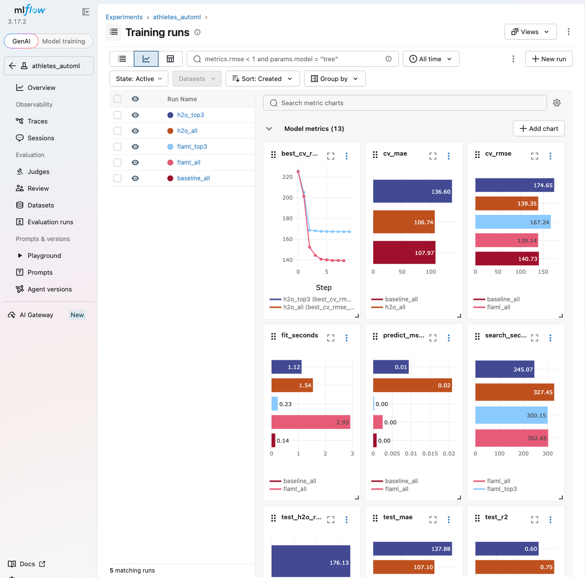

# Assignment 3 report: AutoML on the athletes dataset

This report answers the assignment questions. Every number comes from the files in `results/`, which `python pipeline.py` regenerates. The method (data, folds, budgets, and how speed is measured) is described in the [README](README.md). RMSE and MAE are in pounds of `total_lift`.

## 1. Dataset

The data is `athletes.csv`, cleaned with the rules from Assignment 2 ([crossfit-feature-store-mlops-pipeline](https://github.com/brookerios20/crossfit-feature-store-mlops-pipeline)). The cleaned table has 30,015 athletes, split into 24,046 training rows and 5,969 test rows by hashing `athlete_id` (`results/baseline_all_summary.json`). The target is `total_lift`, the sum of the four lift maxes, and the all-features set has 34 columns: age, height, weight, gender, region, BMI, and 28 one-hot survey answers.

All validation scores below are 5-fold cross-validation RMSE on the training rows, with the same folds for every tool. Test scores come from the held-out test rows, which no model saw during selection.

## 2. Best model on the platform

The platform is the Assignment 2 stack (Prefect for orchestration, MLflow for tracking) with FLAML as the AutoML step. With all features and a 300 s budget, FLAML's best learner is XGBoost with CV RMSE 139.1. Its configuration is 3,701 trees with at most 4 leaves each and a learning rate of 0.017. Refit on the full training split, it scores test RMSE 140.2, MAE 106.9, and R² 0.746. FLAML found it at iteration 83, after 115 s of the 300 s search (`results/flaml_all_summary.json`).

MLflow tracks every run in the experiment `athletes_automl`. The screenshots in `results/screenshots/` show the following:

| File | Contents |
|---|---|
| `mlflow_runs.png` | all five runs with their metrics charted side by side |
| `mlflow_compare.png` | the Compare page with parameters and metrics for each run |
| `mlflow_flaml_run.png` | the `flaml_all` run with its tags and metrics |
| `mlflow_flaml_search.png` | the `flaml_all` search history (best CV RMSE so far at each improving trial) |
| `mlflow_h2o_artifacts.png` | the `h2o_all` artifacts, with the SHAP summary plot open |

## 3. Data insights

The AutoML runs show the following about the data:

- Gender dominates the prediction. Shuffling gender raises FLAML's RMSE by 112 lb, five times more than any other feature (`results/flaml_all_importance.md`). The H2O partial dependence plot puts the mean predicted total lift at about 1,090 lb for men and 770 lb for women (`results/h2o_all_pdp_gender.png`).
- Body size and age come next. In the SHAP summary, higher BMI and higher weight raise the predicted total, and higher age lowers it (`results/h2o_all_shap_summary.png`).
- Many weak features add up. Outside the top four, no feature raises RMSE by more than 3.6 lb when shuffled, yet the top-3 runs, which drop 31 of the 34 features (including weight or age, height, region, and every survey answer), lose 28 to 35 lb of CV RMSE (section 5). Among the survey answers, completing the CrossFit Level 1 course, playing college sports, training others, and doing multiple workouts a day push predictions up. Training for less than 6 months and having no athletic background before CrossFit push them down.
- The data favors nonlinear models. Gradient boosted trees lead both tools, and the linear models trail: FLAML's SGD learner reaches CV RMSE 162.9 and H2O's GLM 148.4 (`results/flaml_all_leaderboard.md`, `results/h2o_all_leaderboard.md`).
- The leading models agree closely, so there is little left for ensembling to gain. FLAML's top three learners fall within 0.6 lb of each other (139.1 to 139.7), and H2O's model correlation heatmap shows strongly correlated predictions across its models (`results/h2o_all_model_correlation.png`). H2O's best stacked ensemble improves on its best single GBM by 0.9 lb.
- CV and test RMSE agree within 1.5 lb for every model in `results/vs_baseline.md`, so no model shows signs of overfitting to the training folds.

## 4. Top 5 features

FLAML ranks features by permutation importance of its best model on 5,000 training rows (`results/top5_features.csv`).

| Rank | Feature | RMSE increase when shuffled (lb) |
|---|---|---|
| 1 | gender | 111.7 |
| 2 | bmi | 21.3 |
| 3 | age | 20.1 |
| 4 | weight | 16.2 |
| 5 | howlong__less_than_6_months | 3.6 |

## 5. Top 3 models by validation score

Validation score is 5-fold CV RMSE on the training split (`results/top3_by_score.csv`). FLAML tunes one configuration per learner, so each row is that learner's best configuration.

### All features

| Rank | Learner | CV RMSE |
|---|---|---|
| 1 | xgboost | 139.1 |
| 2 | xgb_limitdepth | 139.3 |
| 3 | lgbm | 139.7 |

### Top 3 features

The top-3 run uses gender, BMI, and age.

| Rank | Learner | CV RMSE |
|---|---|---|
| 1 | xgb_limitdepth | 167.2 |
| 2 | xgboost | 167.3 |
| 3 | lgbm | 167.5 |

## 6. Top 3 models by speed

Speed is the time to fit each learner's best configuration on the full training split, measured by refitting it once (`results/top3_by_speed.csv`).

### All features

| Rank | Learner | Fit time (s) | Prediction (ms per row) | CV RMSE |
|---|---|---|---|---|
| 1 | rf | 0.044 | 0.0007 | 149.2 |
| 2 | extra_tree | 0.201 | 0.0007 | 145.3 |
| 3 | sgd | 0.303 | 0.0002 | 162.9 |

### Top 3 features

| Rank | Learner | Fit time (s) | Prediction (ms per row) | CV RMSE |
|---|---|---|---|---|
| 1 | extra_tree | 0.017 | 0.0007 | 168.9 |
| 2 | lgbm | 0.068 | 0.0001 | 167.5 |
| 3 | rf | 0.100 | 0.0013 | 167.5 |

The fastest learners are the least accurate with all features. With only 3 features, the five tree learners fall within 1.7 lb of each other, so LightGBM is both one of the fastest and about 0.2 lb behind the best.

## 7. Comparison with the Assignment 2 model

The best AutoML models score within about 1% of the Assignment 2 model, and the Assignment 2 model fits and predicts faster. The Assignment 2 model is `HistGradientBoostingRegressor` with the v2 features and hyperparameter set `hp_a`, rescored on the same folds and test set (`results/vs_baseline.csv`). It reproduces its Assignment 2 test RMSE of 141.3.

| Model | CV RMSE | Test RMSE | Test R² | Fit time (s) | Prediction (ms per row) | Search time (s) |
|---|---|---|---|---|---|---|
| Assignment 2 model | 140.7 | 141.3 | 0.741 | 0.14 | 0.0009 | none |
| FLAML best (xgboost), all features | 139.1 | 140.2 | 0.746 | 2.93 | 0.0025 | 302 |
| FLAML best (xgb_limitdepth), top 3 features | 167.2 | 167.2 | 0.638 | 0.23 | 0.0003 | 300 |
| H2O best (StackedEnsemble_AllModels_1), all features | 139.4 | 140.0 | 0.746 | 1.54 | 0.0208 | 327 |
| H2O best (StackedEnsemble_AllModels_1), top 3 features | 174.7 | 176.1 | 0.598 | 1.12 | 0.0094 | 245 |

### Validation score

The best AutoML models improve on the Assignment 2 model by 1.2 lb (FLAML) and 1.4 lb (H2O) of test RMSE, under 1% in both cases, and R² rises from 0.741 to 0.746. The top-3 feature models are 26 to 35 lb worse than the Assignment 2 model, because it uses all 34 features.

### Speed

The FLAML winner takes 21 times longer to fit than the Assignment 2 model (2.93 s against 0.14 s) and about 3 times longer per prediction, because it grows 3,701 trees against 100. Finding it also cost a 5-minute search. H2O's stacked ensemble reports 1.54 s of fit time, which covers only its metalearner. The full H2O run, including the 20 base models the ensemble combines, took 5.5 minutes.

## 8. No-code, low-code, or full-code

FLAML is a low-code AutoML library, and the pipeline around it is full-code. The course gives two definitions:

- Lecture 4 (slide 80) defines low-code as declarative APIs or libraries "where pipelines are defined in a few lines of code, abstracting away the training loops and hyperparameter tuning". FLAML fits this definition: one `AutoML().fit(X, y, task="regression", time_budget=300)` call replaces algorithm selection, hyperparameter tuning, and cross-validation.
- Discussion 3 (slide 48) defines full-code as writing code with libraries such as scikit-learn, and low-code as graphical tools with some configuration or scripting. Under this definition FLAML is full-code, because it has no graphical interface.

The Prefect flow, the MLflow logging, the shared folds, and the comparison tables are written by hand, which places the pipeline as a whole at the full-code end of the spectrum on Lecture 4, slide 83. Both definitions reserve no-code for drag-and-drop graphical tools, so FLAML falls outside it.

## 9. H2O AutoML

H2O AutoML ran on the same data, folds, and test set, with 20 models per run plus 2 stacked ensembles. Its models carry long IDs such as `StackedEnsemble_AllModels_1_AutoML_1_20261031_182303`, which this section shortens by dropping the `_AutoML_...` suffix. The full IDs are in `results/h2o_*_leaderboard.csv`.

### Best model

The leader is StackedEnsemble_AllModels_1, which combines all 20 base models. It reaches CV RMSE 139.4, test RMSE 140.0, MAE 107.1, and R² 0.746 (`results/h2o_all_summary.json`).

### Data insights

H2O's results agree with FLAML's and add the following:

- Across algorithms, the best model of each family ranks GBM (140.3), XGBoost (141.7), random forest (144.5), GLM (148.4), and deep learning (150.2) by CV RMSE. Tree ensembles again lead and the linear model trails.
- Deep learning is both the least accurate family and the slowest, at 19.8 s of training against 0.4 s for the best GBM.
- The variable importance heatmap shows the model families weighting features differently (`results/h2o_all_varimp_heatmap.png`). Most GBM and XGBoost models give gender about half or more of their scaled importance. The GLM, the random forests, and the deep learning models give gender 0.3 or less, and the deep learning models and GLM give region more weight than the tree models do.

### Top 5 features

H2O ranks features by the variable importance of its best non-ensemble model, GBM_5 (`results/top5_features.csv`).

| Rank | Feature | Share of importance |
|---|---|---|
| 1 | gender | 46.1% |
| 2 | weight | 22.5% |
| 3 | bmi | 7.4% |
| 4 | age | 4.1% |
| 5 | height | 3.8% |

FLAML and H2O agree on four of the five features. They differ in order, because FLAML measures permutation importance and H2O measures the share of split gain, and in the fifth feature (FLAML picks training for less than 6 months, H2O picks height).

### Top 3 models by validation score

The top-3 run uses gender, weight, and BMI.

| Feature set | Rank | Model | Algorithm | CV RMSE |
|---|---|---|---|---|
| All | 1 | StackedEnsemble_AllModels_1 | StackedEnsemble | 139.4 |
| All | 2 | StackedEnsemble_BestOfFamily_1 | StackedEnsemble | 139.5 |
| All | 3 | GBM_5 | GBM | 140.3 |
| Top 3 | 1 | StackedEnsemble_AllModels_1 | StackedEnsemble | 174.7 |
| Top 3 | 2 | StackedEnsemble_BestOfFamily_1 | StackedEnsemble | 174.8 |
| Top 3 | 3 | GBM_2 | GBM | 174.9 |

### Top 3 models by speed

H2O reports training time per model. A stacked ensemble's time covers only its metalearner.

| Feature set | Rank | Model | Fit time (s) | Prediction (ms per row) | CV RMSE |
|---|---|---|---|---|---|
| All | 1 | GLM_1 | 0.143 | 0.0012 | 148.4 |
| All | 2 | GBM_grid_1_model_1 | 0.337 | 0.0074 | 141.2 |
| All | 3 | GBM_2 | 0.372 | 0.0080 | 140.5 |
| Top 3 | 1 | GLM_1 | 0.045 | 0.0008 | 183.3 |
| Top 3 | 2 | GBM_5 | 0.101 | 0.0045 | 175.0 |
| Top 3 | 3 | GBM_grid_1_model_1 | 0.107 | 0.0048 | 175.1 |

GBM_2 is the third-fastest H2O model with all features and scores 0.2 lb behind GBM_5, the most accurate single model, which makes it the best single-model tradeoff in this run.

### Comparison with FLAML

With all features, H2O's best test RMSE is 0.2 lb lower than FLAML's, a gap too small to separate the two tools on one test split. With 3 features, FLAML scores 7.4 lb better in CV RMSE. Its third feature is age, where H2O's is weight, which overlaps with BMI. H2O times its models on its Java server, and FLAML and the baseline are timed by refitting in Python, so each speed table ranks models within one tool.

## Assisting sources

Claude Opus 5.5 (Anthropic).
